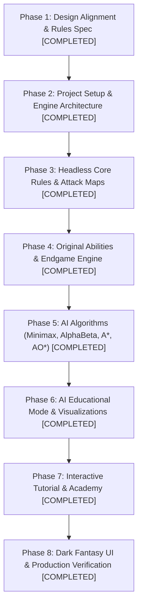

# CROWNFALL — Master Development Plan & Execution Log

## 1. Executive Summary

**CROWNFALL: The Last Kingdom** has been completely developed, tested, and verified as a modular, responsive browser-based tactical strategy game. All custom abilities, endgame resolution states, genuine AI search algorithms, educational visualizations, and interactive tutorials have been implemented to specification.

---

## 2. Completed Roadmap Status

---

### Phase 1: Rules & Geometry Specification [COMPLETED]
- [x] Board geometry: 8×8 square grid with configurable coordinates and baselines (`config/boardConfig.ts`).
- [x] Army composition: Symmetric mirrored back ranks with 6 special unit types and 8 Soldiers (`config/startingFormation.ts`).
- [x] Seeded PRNG for reproducible Bastion BASH displacement and AI simulations (`utils/seededRng.ts`).

### Phase 2: Headless Core Rules Engine [COMPLETED]
- [x] Pure TypeScript game model with full history snapshots (`engine/gameState.ts`).
- [x] All 6 piece movement patterns (`engine/moveGenerator.ts`).
- [x] Real-time attack map with zone control, protectors, threats, pins, and forks (`engine/attackDetection.ts`).

### Phase 3: Original Unit Abilities [COMPLETED]
- [x] **Regent**: 8-direction movement, standard chess check & checkmate rules, mandatory defense (`engine/pieces.ts`, `engine/moveGenerator.ts`).
- [x] **Champion**: 8-direction raycast attack, immune to Oracle conversion (`engine/conversionHandler.ts`).
- [x] **Rider**: N/S (↕) vs E/W (↔) directional axis movement, rotation consuming turn, bi-directional indicators (`engine/riderOrientation.ts`).
- [x] **Oracle**: Divine Conversion vs Normal Capture choice, sacrifice mechanic, mutual Oracle destruction (`engine/conversionHandler.ts`).
- [x] **Bastion**: BASH random displacement, crush on trap, Siege Mode unlock, Enhanced 2-Target BASH, Soldier Leap (`engine/bastionAbilities.ts`).
- [x] **Soldier**: Forward & sideways movement (5 directions, no backward), Friendly Elimination, baseline promotion to Champion/Rider/Bastion (`engine/promotionHandler.ts`).

### Phase 4: Chess Check & Checkmate Endgame [COMPLETED]
- [x] Regent cannot step into check (attacked square is illegal).
- [x] Pinned units cannot move off their pin line to expose Regent.
- [x] When in check, player must resolve check (escape, block, or capture attacker).
- [x] Checkmate detection triggers immediate victory for attacker.
- [x] Stalemate detection triggers honorable draw resolution (`engine/gameState.ts`).

### Phase 5: Artificial Intelligence Engine [COMPLETED]
- [x] **Minimax**: Adversarial minimax search alternating maximizing/minimizing (`algorithms/minimax.ts`).
- [x] **Alpha-Beta Pruning**: $[\alpha, \beta]$ cutoff bounds, branch pruning, move ordering, stochastic BASH chance nodes (`algorithms/alphaBeta.ts`, `ai/chanceNodes.ts`).
- [x] **A\* Search**: $f(n) = g(n) + h(n)$ pathfinding with Chebyshev heuristic and Rider axis constraints (`algorithms/astar.ts`).
- [x] **AO\* Search**: True AND-OR hypergraph planner for compound kingdom doctrines (`algorithms/aostar.ts`).
- [x] **Difficulty Presets**: Beginner, Intermediate, and Expert presets (`ai/difficulty.ts`, `ai/opponent.ts`).

### Phase 6: AI Educational Mode & Visualizations [COMPLETED]
- [x] Live search metrics (Evaluated Nodes, Pruned Branches, Score, Execution Time).
- [x] Interactive Minimax and Alpha-Beta decision tree explorer.
- [x] Interactive A\* open/closed sets and coordinate inspector.
- [x] Interactive AO\* AND-OR graph visualizer with solved hyperpath.
- [x] Live Head-to-Head Benchmark comparing Minimax vs Alpha-Beta on current board positions.

### Phase 7: Interactive Tutorial Academy [COMPLETED]
- [x] 9 step-by-step interactive lessons with real board validation (`tutorials/tutorialData.ts`, `components/Tutorial/TutorialModal.tsx`).

### Phase 8: UI/UX & Verification [COMPLETED]
- [x] Dark fantasy kingdom aesthetic with gold & silver accents.
- [x] Multi-screen flow (Splash screen with animated starfield, Mode selection, Difficulty tier selector).
- [x] High-fidelity 3D fantasy character piece renders with kingdom color tinting and badges.
- [x] 32/32 unit tests passing with Vitest (`npm test`).
- [x] Production build passes cleanly with zero TypeScript errors (`npm run build`).
